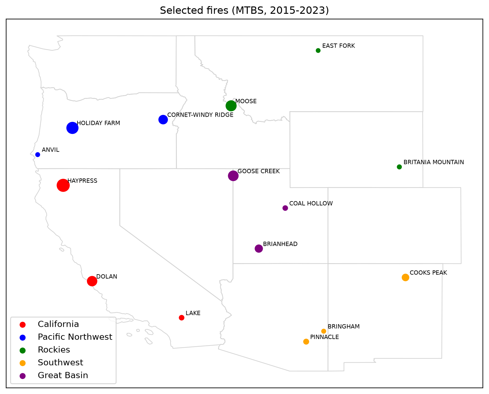

# Post-Fire Vegetation Recovery

CS 497/597 Computer Vision final project, Boise State University, Fall 2026.
Roberto Jones, Angie Bui, Santiago Vargas.

We fine-tune Prithvi-EO-2.0 on HLS time series to track and forecast vegetation recovery in burn scars across the western US. As a stretch goal, we test if an updated burn map makes the USGS M1 debris-flow model better.

## Repo layout

```
notebooks/   step-by-step notebooks (run in order)
scripts/     command-line steps that run on Borah or Colab
docs/        how-tos (docs/borah.md: running things on Borah)
data/fires/  fires.csv, candidates.csv and the Wapiti perimeter (small tables only, no imagery)
```

The image chips are too big for git. They live in Google Drive (`cs497_hls_chips`) and get copied to Borah for training.

## Steps

| # | File | What it does | Output |
|---|----------|--------------|--------|
| 1 | `01_select_fires.ipynb` | Picks ~15 MTBS wildfires (2015–2023), 3 per region, plus the 2024 Wapiti Fire | `fires.csv`, `candidates.csv` |
| 2 | `02_export_hls.ipynb` | Cuts each fire into 224 × 224 chips and exports monthly HLS composites (2 years before the fire → last month), static layers and monthly gridMET weather to Google Drive | `chips_manifest.csv`, GeoTIFFs + `gridmet_monthly.csv` in Drive (`cs497_hls_chips`) |
| 3 | `scripts/build_dataset.py` | Reads the chips and computes NBR/NDVI, burned pixels, recovery % and years to recovery; makes the fire / time / region splits. Run on Borah (`docs/borah.md`) or Colab | one `.npz` per chip, `chips.csv`, `chip_months.csv`, `splits.json` |

## Selected fires



The interactive version is `figures/fires_map.html`.

## Setup

Each of us uses our own Google Cloud project with Earth Engine enabled. Put its ID in a file called `ee_project.txt` at the repo root (git ignores it):

```bash
echo "your-project-id" > ee_project.txt
```

**Locally (VS Code):**

```bash
python3 -m venv .venv
source .venv/bin/activate
pip install -r requirements.txt ipykernel
```

Then open a notebook, pick the `.venv` kernel and Run All. The first time, it asks you to log in to Earth Engine.

**Colab:** open the notebook from GitHub, set `PROJECT_ID` in the first cell and Run All. It also asks to mount Google Drive.

Please clear the notebook outputs before committing, so diffs stay small.

## Data sources

- MTBS burned area boundaries and burn severity mosaics (USFS/USGS)
- HLS v2.0, Landsat 30 m (HLSL30) and Sentinel-2 30 m (HLSS30) (NASA)
- NLCD 2019 release land cover (USGS)
- gridMET (weather) and SRTM (terrain), added in step 2
- Wapiti Fire perimeter from its RECOVER data package (final perimeter, Oct 19, 2024)

All of them are read through Google Earth Engine.
